<!-- every image sits in <picture> so GitHub does not turn it into a link to the raw file -->

<picture></picture>

 

<picture></picture>

 

<picture></picture>

 

<picture></picture>

## 🎒 Inventory

  <picture></picture>

  <picture></picture>
  <picture></picture>
  <picture></picture>
  <picture></picture>

## 🗺️ Quest log

| | Quest | Reward |
|:-:|---|---|
| ✅ | Build business apps that open right inside Power Apps | +500 XP, fewer spreadsheets |
| ✅ | Connect an AI agent to an ERP from 2012 and survive | 🏆 *Necromancer* |
| ✅ | Automate my own to-do list (then automate the automation) | infinite loop detected |
| ⏳ | Ship the senior design project: Farm Inventory Manager 🐄 | a diploma, hopefully |
| 🔒 | Get Dataverse to stop throttling me | *quest locked* |

## 🐍 A snake is eating my contributions

  <picture>
    <source media="(prefers-color-scheme: dark)" srcset="https://raw.githubusercontent.com/vusallmammad/vusallmammad/output/github-snake-dark.svg"/>
    
  </picture>

most of my commits live in private repos, so the snake is on a diet 🥗

<picture></picture>

banner, terminal and character sheet are hand-made animated SVGs → <code>tools/build_svgs.py</code>

